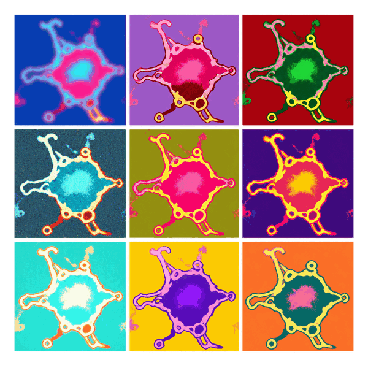
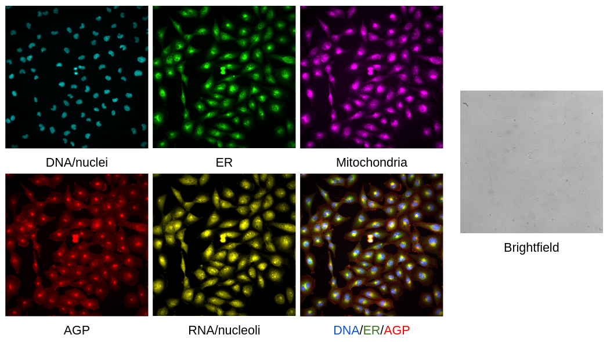

<h1>
  
  PedCP90
</h1>

[](https://doi.org/10.5281/zenodo.15548848)

This repository contains the image analysis and image-based profiling of the pediatric cancer Cell Painting pilot experiment that preceded the Pediatric Cancer Cell Morphology Atlas (PCCMA).
We acquired four rounds of pilot plates to determine the best seeding density, time point, and plating condition for each cell line, and we use this repository to extract single-cell morphological profiles from them and format the profiles for downstream analysis.

The two plate layouts of the first round make up **PedCP90**: 18 pediatric cancer cell lines, each at five seeding densities (18 x 5 = 90 conditions), on two 384-well plates from a single imaging batch (380 wells).
Round 1 was imaged at three time points (24, 48, and 72 hours), and the PedCP90 evaluation uses one of them.
PedCP90 was first reported in [Li and Way (2026), *On doubting image quality assessment metrics for microscopy virtual staining*, bioRxiv](https://doi.org/10.64898/2026.08.31.748410), which used it to evaluate image quality assessment metrics for virtual staining.
The CellProfiler processing of PedCP90 described there is in the [illumination correction](./1.illumination_correction/) and [feature extraction](./2.feature_extraction/) modules.

## PedCP90 datasets

The preprint uses three related datasets, and each has its own logo.
The logos share the PedCP90 name and color the part that distinguishes each dataset.

| Dataset | Description |
| --- | --- |
|  | The real Cell Painting images of 18 pediatric cancer cell lines at five seeding densities (90 conditions), which this repository processes. The preprint uses it as the reference image set. |
|  | A simulated dataset. We add six types of controlled degradation, each at six graded severities, to the real PedCP90 fluorescence images, so the type and severity of the error are known. |
|  | A virtual staining dataset. Three model architectures, each trained at five seeding densities (15 models), predict the Cell Painting fluorescence channels from brightfield images of unseen cell lines, so the errors are realistic and their severity is unknown. |

We derive PedCP90Sim and PedCP90VS from PedCP90.
The code for the analysis is in [`virtual_staining_metric_analysis`](https://github.com/WayScience/virtual_staining_metric_analysis), and the code for training the virtual staining models is in [`virtual_stain_flow`](https://github.com/WayScience/virtual_stain_flow).

## Cell Painting

We performed a traditional [Cell Painting assay](https://www.nature.com/articles/nprot.2016.105) on multiple different pediatric cancer cell lines.
Images were acquired using an Opera Phenix 1 High Content Screening System.

In this assay, we have six channels (five Cell Painting + Brightfield).
These channels are listed in the number order that you can find for the TIFF images, with the channel name in the XML file bolded:

1. **Brightfield high**
2. Concanavalin A **Alexa 488** - Endoplasmic reticulum (ER)
3. Phalloidin and WGA **Alexa 568** - Actin, Golgi, and plasma membrane (AGP)
4. MitoTracker **Alexa 647** - Mitochondria
5. **Hoechst 33342** - DNA/nucleus
6. SYTO14 **Alexa 488 long (CP)** - Cytoplasmic RNA and nucleoli



## Data

### Pilot dataset

We acquired four rounds of pilot plates.
Each round has two to five plate layouts (platemaps), and every layout was imaged at three time points (24, 48, and 72 hours), so each layout is three plates.
In total, there are 13 layouts and 39 plates:

| Round   | Layouts (platemaps)        | Plates | Plate barcodes (lowest to highest) |
| :------ | :------------------------- | -----: | :--------------------------------- |
| Round 1 | `Assay_Plate1` – `2`       |      6 | `BR00143976` – `BR00143981`       |
| Round 2 | `Assay_Plate3` – `4`       |      6 | `BR00145438` – `BR00145818`       |
| Round 3 | `Assay_Plate5` – `8`       |     12 | `BR00146998` – `BR00147497`       |
| Round 4 | `Assay_Plate9` – `13`      |     15 | `BR00147482` – `BR00148802`       |

Round 1 contains the PedCP90 layouts: `Assay_Plate1` has 12 cell lines and `Assay_Plate2` has 7, with U2-OS on both, which makes 18 distinct cell lines and 380 wells. All three time points were imaged; PedCP90 evaluates one of them.
The full barcode-to-layout-to-time-point map is in [`0.download_data/metadata/platemaps/Barcode_platemap_pilot_data.csv`](./0.download_data/metadata/platemaps/Barcode_platemap_pilot_data.csv).

Per plate, there are five different seeding densities for each cell line (1000, 2000, 4000, 8000, and 12000 cells per well), with typically four replicate wells for each cell line, plating condition, and seeding density in a layout.
Each layout has a plating condition, such as:

1. `standard`
2. `synthemax` (Synthemax coated)
3. `laminin` (laminin coated)
4. a `_PFA` variant of each (`standard_PFA`, `synthemax_PFA`, `laminin_PFA`)

The platemap files are in the [metadata folder](./0.download_data/metadata/platemaps/) and the layout figures are in [`platemap_figures`](./0.download_data/platemap_figures/), both inside the download data module.

We used multiple methods to determine what are the best conditions per cell line.
One method is single-cell quality control (QC), which outputs a QC report of which seeding densities and time points yielded the worst quality segmentations.
This can be due to high confluence or poor staining.
Another method is pairwise Pearson's correlation, which computes how similar wells are within the same cell line (and against a shuffled baseline).

**NOTE:** All plate layouts contain the U2-OS cell line, which is used as an "anchor" to compare profiles across plates and for developing segmentation parameters.
Also, any empty portions of the layout contain media and no cells so they are not included on figure or in the platemap files.

## Repository structure

| Module                                                    | Purpose                               | Description                                                                                                                                    |
| :-------------------------------------------------------- | :------------------------------------ | :--------------------------------------------------------------------------------------------------------------------------------------------- |
| [0.download_data](./0.download_data/)                     | Download plates and platemaps         | Instructions to download the images and XML files. All platemaps and layout figures (metadata) are in this module.                             |
| [1.illumination_correction](./1.illumination_correction/) | Save illumination correction function | Perform illumination correction on the raw images and extract the function as an `npy` to apply during feature extraction. Also extracts image quality metrics. |
| [2.feature_extraction](./2.feature_extraction/)           | Extract morphology features           | Using CellProfiler, images are corrected, segmented for cell compartments and features are extracted and outputted as SQLite files.            |
| [3.preprocessing_features](./3.preprocessing_features/)   | Preprocess morphology profiles        | Format the SQLite output into single-cell profiles and perform single-cell QC and pycytominer to get normalized and feature selected profiles. |
| [4.optimization](./4.optimization/)                       | Determine optimal conditions          | Perform analyses to determine the best conditions for each cell line in the pilot datasets (pairwise correlation versus a shuffled baseline, and versus the QC failure rate). |

## Environments

In this repository, we include four environments in the [environments](./environments/) folder, plus a script to build all of them on an HPC:

- **[CellProfiler environment](./environments/cellprofiler_env.yml)** (`alsf_cp_env`): used for the illumination correction and feature extraction modules, as we used CellProfiler v4.2.8 to perform these tasks.
- **[Image profiling environment](./environments/preprocessing_env.yml)** (`alsf_preprocessing_env`): used in the preprocessing module after we extracted morphology features using CellProfiler, and includes pycytominer, CytoTable, and coSMicQC.
- **[R environment](./environments/r_environment.yml)** (`alsf_r_analysis`): used for any notebook that requires visualization of results and figure generation in the R language (the platemap figures and the optimization boxplots).
- **[Optimization environment](./environments/optimization_env.yml)** (`optimization_env`): used for the optimization analyses (pairwise correlation and the correlation versus QC plots).
- **[`hpc_create_envs.sh`](./environments/hpc_create_envs.sh)**: creates or updates every environment above on the Alpine HPC (it reads each environment's name from its first line).

These environments can be installed either via conda or mamba.
Below is an example of how to install one via the terminal.

```bash
# Make sure to be in the environments folder
mamba env create -f cellprofiler_env.yml
```

## Citations

If you use or reference this work in your own projects, please cite us.
You can find citation information in the 'cite this repository' link at the top right under about section within GitHub.
This information may also be referenced within the [`CITATION.cff`](CITATION.cff) file.
